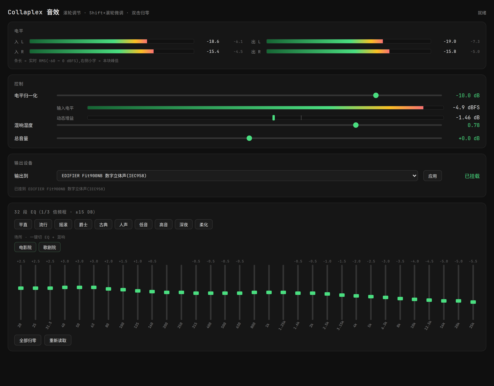

# Collaplex Spatial Audio

**Collaplex 音效 —— 把 Linux 的系统输出接成一条耳机空间音效链。**
Spatial audio for headphones on Linux — a PipeWire chain driven by in-house DSP.

包名与命令名：`collaplex-audio`。

`Linux` · `PipeWire` · `全链 96 kHz` · `本地控制面板` · `AGPL-3.0-or-later`



## 概述

耳机听立体声有两个固有问题：所有声音挤在头里，出不了房间；不同内容的响度又差得远，切一首歌就得动音量。Collaplex 音效用一条 PipeWire 效果链接住系统输出，按顺序解决这两件事，再按耳机和听音偏好做校正：

- **双耳渲染**：真人测量的 HRTF（SADIE II / H4）+ 3 秒房间混响，把声场外化到头部以外，不再「头中效应」。
- **响度归一化**：能量滑窗 + 限速，把不同源的响度拉到同一档，同时不压动态。
- **32 段均衡**：1/3 倍频程，10 个常用口味预设，另有「电影院 / 歌剧院」两个按场所声学特性设计的组合。

所有参数**实时生效并落盘**，重启后自动恢复。链路不修改系统音频配置、不做开机自启：手动 `start` 才接管，`stop` 即还原。

## 功能

| 功能 | 说明 |
|---|---|
| 双耳 HRTF | SADIE II 受试者 H4，96 kHz / 24 bit，前左 + 前右共 4 路卷积 |
| 房间混响 | 3 秒双声道 IR（房间模型程序化生成）+ 独立湿量增益级，滑块实时可调 |
| 响度归一化 | 目标 −14 dBFS，能量滑窗 + 6 dB/s 限速；左右声道共享增益，声像不漂 |
| 32 段 EQ | 20 Hz ~ 25 kHz，1/3 倍频程，每段 ±15 dB，10 个预设 + 2 个场所组合 |
| 总音量与软限幅 | ±12 dB；限幅介入点 −0.63 dBFS，贴顶样本 0% |
| 实时面板 | 62 Hz SSE 推送：4 路电平表、归一化增益、湿量、总音量、设备状态 |
| 输出设备管理 | 下拉选硬件输出并落盘；守护线程每 3 秒核对，设备晚到时自动挂上 |
| 参数持久化 | EQ / 总音量 / 湿量落盘到 `~/.local/state/cinema-spatial/`，共享内存被清空后自动恢复 |
| 零侵入 | 不写系统 PipeWire 配置、不开机自启；`stop` 后默认输出回到原设备 |

## 信号链

```
全局音频（应用输出）
  → collaplex_vsink        虚拟声卡（系统默认输出）
  → 响度归一化             pipe DSP ×2（左右各一进程，flock 共享增益）
  → collaplex_hrtf_in     双耳 HRTF（SADIE II / H4，4 路卷积）
  → 房间混响              convolver（3 秒 IR）+ 湿量级（pipe DSP ×2）
  → collaplex_eq_in       32 段 EQ + 总音量 + 软限幅（pipe DSP ×2）
  → 数字输出（S/PDIF 或所选硬件设备）
```

共 **6 个节点 + 6 个 DSP 进程**，全链 96 kHz。每个效果级都是独立实例，可以单独 `pw-play` 推流验证，不必在主链路上串联调试。

## 安装

**系统要求**：Linux + PipeWire + WirePlumber + `python3-numpy` + `python3-scipy`。

**deb 包（推荐）**

```sh
sudo dpkg -i collaplex-audio_1.0.2_all.deb
collaplex-audio start          # 装完不会自动接管，必须执行这一步
```

**从源码**

```sh
git clone https://collaplex.me/git/edgevoid/collaplex-audio.git
cd collaplex-audio
collaplex-audio start          # 等价于 bash 脚本/安装.sh
```

## 使用

```sh
collaplex-audio start    # 启动：部署配置 → 重载 PipeWire → 自检
collaplex-audio stop     # 停止：恢复系统默认输出，同时关掉面板
collaplex-audio web      # 打开控制面板（http://127.0.0.1:8789）
```

- `WET=0.4 bash 脚本/安装.sh`：指定初始湿量（默认 0.3）
- `WEB_PORT=8899 collaplex-audio web`：换面板端口

**开机自启**：链路本身不需要服务——4 份配置部署在 `~/.config/pipewire/pipewire.conf.d/`，PipeWire 启动即加载，`start` 跑过一次就长期有效。面板用 systemd 用户服务 `collaplex-audio-panel.service` 登录自启，`start` 时自动安装并 enable。要取消：

```sh
systemctl --user disable --now collaplex-audio-panel.service
collaplex-audio stop
```

音频设备与 PipeWire 都是用户级的，所以「开机自启」实际是**登录自启**。

## 控制面板

打开方式：`collaplex-audio web` → http://127.0.0.1:8789

| 区域 | 内容 |
|---|---|
| 电平 | 双声道 4 个表：入 L / 出 L / 入 R / 出 R。条长 = 实时 RMS（−60 ~ 0 dBFS），小字 = 本块峰值 |
| 电平归一化 | 目标滑块 + 输入电平条 + 动态增益推子（0 dB 在 60% 刻度，量程 −18 ~ +12 dB） |
| 混响湿度 | 0 ~ 1，实时生效 |
| 总音量 | ±12 dB，实时生效 |
| 输出设备 | 下拉选择硬件输出 + 「应用」，右侧显示挂载状态 |
| 32 段 EQ | 1/3 倍频程，每段 ±15 dB，10 个预设 + 「场所」联动 |

- 所有滑块：滚轮调节 · Shift+滚轮微调 · 双击归零
- 面板刷新 62 Hz（SSE 推送），表头快起慢落、峰值保持 1.6 秒
- 参数走共享内存 `/dev/shm/collaplex-eq`（版本号保证不会读到半更新），改参数不用重装

## 场所预设

「场所」按钮一次切换 EQ 与混响湿量，两者都按现实厅堂的声学特性设计：

| 场所 | 设计依据 | 混响时间 | 湿量 |
|---|---|---|---|
| 电影院 | 高频按 X-curve（ISO 2969）每倍频程 −1.5 dB，叠银幕透声损失；25~60 Hz +2.5~3 dB 补 LFE 体感；200~400 Hz 略降 | 0.4 ~ 0.8 s | 0.35 |
| 歌剧院 | 150~400 Hz 抬 +2 dB（木质厅堂温暖感）；2~5 kHz 抬 +0.5~1 dB（无扩声，靠 presence 投射）；高频缓降 | 1.4 ~ 1.8 s | 0.78 |

两者实测差异：影院 25~60 Hz 比歌剧院重 **+3.4 dB**；歌剧院 3.15~5 kHz 与 8~16 kHz 分别足 **+3.0 / +3.5 dB**。总音量不随场所切换——那是个人的听音响度。

## 实测

所有指标都由 `测试/` 下的脚本对真实链路测得，不是设计目标值：

| 指标 | 实测 |
|---|---|
| 响度归一化 | 输入差 20.00 dB → 输出端差 **0.00 dB** |
| 双耳化 | 出口左右相关系数 **0.679**（直通 = 1.000） |
| 混响 | 湿量 0 无尾巴；湿量 1 时 3 秒平滑衰减（−11 → −129 dBFS） |
| 总音量线性 | +6 / +12 dB → RMS +5.99 / +11.20 dB |
| 软限幅 | +12 dB 时峰值 **−1.11 dBFS**，贴顶样本 0% |
| 谐波失真 | 纯音 +0 / +6 dB：**−91.1 dB**（相对基频） |
| 底噪 | 旁路与经链均为 −240 dBFS，链路不自造噪声 |
| 面板刷新 | **62 Hz**（2 秒 124 帧） |
| 输出设备守护 | 连线被拆后 **2~3 秒**自动挂回 |

低频过量问题修复前后的对照（同素材、同脚本）：

| 指标 | 修复前 | 修复后 |
|---|---|---|
| HRTF + EQ 低频（20~200 Hz 相对 1 kHz） | +7.5 dB | **−0.1 dB** |
| 再加混响 | +13.6 dB | **+0.2 dB** |
| 整链峰值因子 | 2.0 dB | **12.2 dB** |
| 软限幅介入样本 | 50.49% | **0.00%** |

诊断与修复过程见 [doc/设计说明.md](doc/设计说明.md)。

## 与商业虚拟器的差别

| | Dolby Atmos for Headphones 等 | 本链路 |
|---|---|---|
| 输入 | 多声道 / Atmos 对象 → 双耳渲染 | **仅立体声** → 双耳化 + 房间混响 |
| HRTF | 专有平均模型，不可查、不可换 | SADIE II H4 真人测量，文件可换 |
| 可调性 | 固定预设 | 32 段 EQ + 湿量 + 总音量 + 场所联动，全部实时 |
| 可测量性 | 黑盒 | 每一级都能单独推流、单独测 |

**边界要说清**：本链路只处理立体声，不具备 Atmos 对象音频的逐方向定位能力——片源是 5.1/Atmos 时，专业渲染器的定位会明显更强。这里的空间感来自 HRTF 外化 + 房间混响，不是多声道渲染。

对比听感前请先对齐响度：本链路比直出响 +15.1 dB，不对齐时「更响的那个」几乎总显得更好。

## 限制

- **仅 Linux + PipeWire**：依赖 PipeWire 的 filter-chain 与 `pipe` 插件，不支持 Windows / macOS。
- **仅立体声输入**：不做多声道下混与对象音频渲染。
- **全链锁定 96 kHz**：IR 按 96 kHz 处理，输出设备不支持时由 PipeWire 重采样。
- **面向耳机**：HRTF 与房间混响是为耳机外化设计的；外放使用需自行调 EQ。

## 开发

```sh
uvx pyright --project pyrightconfig.json                        # 类型检查（要求 0 errors）
bash 打包deb.sh                                                  # 出 deb 到 发布/
uv run --with websocket-client python 测试/cdp_拖动验证.py        # CDP 真鼠标验证
```

实现细节、踩过的坑、逐项诊断数据：[doc/设计说明.md](doc/设计说明.md)。

## 许可

**双授权**，详见 [LICENSING.md](LICENSING.md)：

- 开源：**AGPL-3.0-or-later**，允许商用；分发衍生作品或以网络服务形式提供时，须以同一许可开放完整对应源码。
- 商业：闭源集成、预装 / OEM 分发、定制开发需购买商业授权。
- 第三方素材：`hrir/` 的 SADIE II 数据为 **Apache-2.0**（University of York 音频实验室），允许商用。

当前版本 **1.0.2**。第一代实现见 `edgevoid/cinema-spatial`，第二代（本项目）为推倒重构：每个效果级独立实例 + 自研 DSP，参数实时生效。
